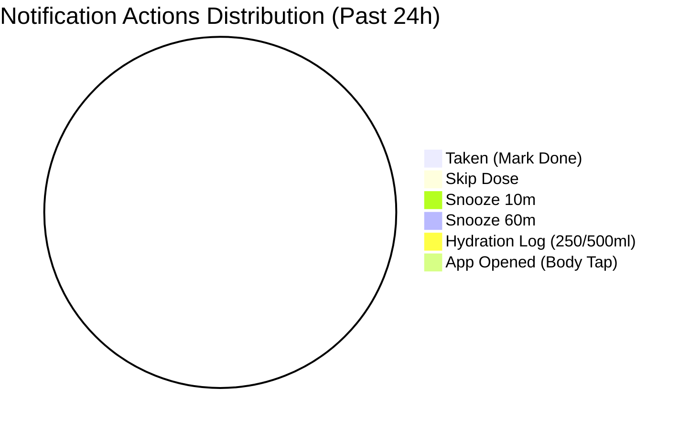

# 🛡️ PillCare Chief Engineer Technical Diagnostic Report

> **Report ID**: `sentinel_2026-10-15_fafd37c7`  
> **Generated At**: 2026-10-15 20:07:15 UTC  
> **Analysis Window**: Past 24 Hours  
> **Agent**: PillCare Autonomous Sentinel Agent v2.0  

---

## 1. Executive Health Summary

| Metric | Status / Value | Assessment |
| :--- | :--- | :--- |
| **Total Crashes Recorded** | `0` | ✅ Zero Unhandled Crashes |
| **Unique Crash Signatures** | `0` | ✅ Clean |
| **Notification Action Interactions** | `0` | ⚠️ Low Bar Action Rate |
| **Doses Marked Taken** | `0` | Core MVP Adherence Funnel Active |
| **Total Telemetry Events Logged** | `0` | Ingestion Pipeline Operational |

---

## 2. Notification Bar Interaction & Funnel Health

### Action Breakdown:
- **`MARK_TAKEN`**: 0 clicks
- **`SKIP_DOSE`**: 0 clicks
- **`SNOOZE_10`**: 0 clicks
- **`SNOOZE_60`**: 0 clicks
- **`LOG_250ML`**: 0 clicks
- **`BODY_TAP` (Direct App Open)**: 0 clicks

---

## 3. Crash Radar & Exception Triage

✅ **No unhandled frontend crashes or runtime exceptions detected in this reporting window.**

---

## 4. Architectural & Cost Optimization Diagnostics

✅ **All monitored subsystems operating within optimal performance thresholds.**

---

## 5. Engineer Action Items & Recommendations

1. **Notification Engine**: Confirm that `TaskManager.defineTask` is initialized in mobile app bundle root to guarantee background action execution on Android & iOS.
2. **Local-First Bootstrap**: Ensure multi-device sign-in initiates `api.syncState()` to hydrate hydration and yoga progress into local `AsyncStorage`.
3. **Cloud Run Invocations**: Validate that tab switching enforces the 5-minute SWR cache TTL, dropping redundant backend calls to near zero.

---
*Report generated automatically by PillCare Chief Engineer Sentinel Agent.*
