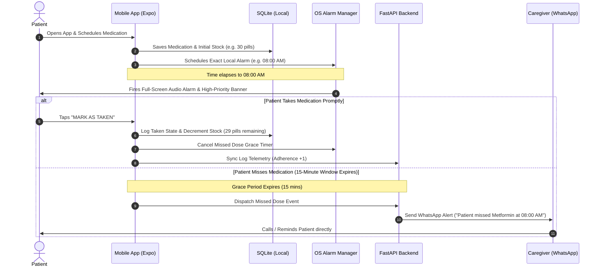
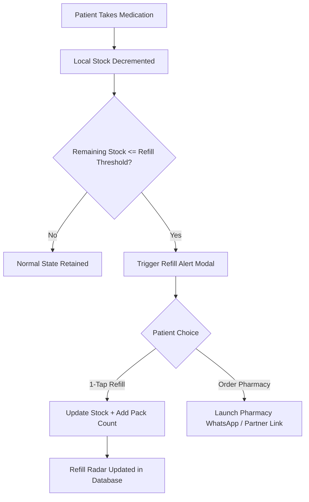
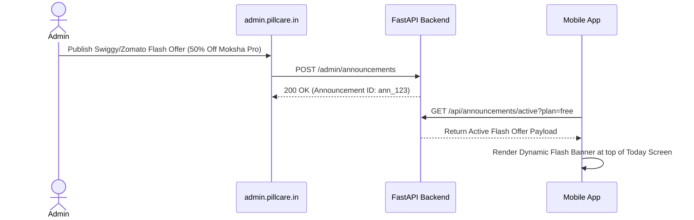

# PillCare - User Flows & Patient Journeys

## 1. Primary Patient Journey (Dose Logging & Caregiver Shield)

---

## 2. Refill Automation Flow

---

## 3. Admin Overrides & Flash Announcement Flow

