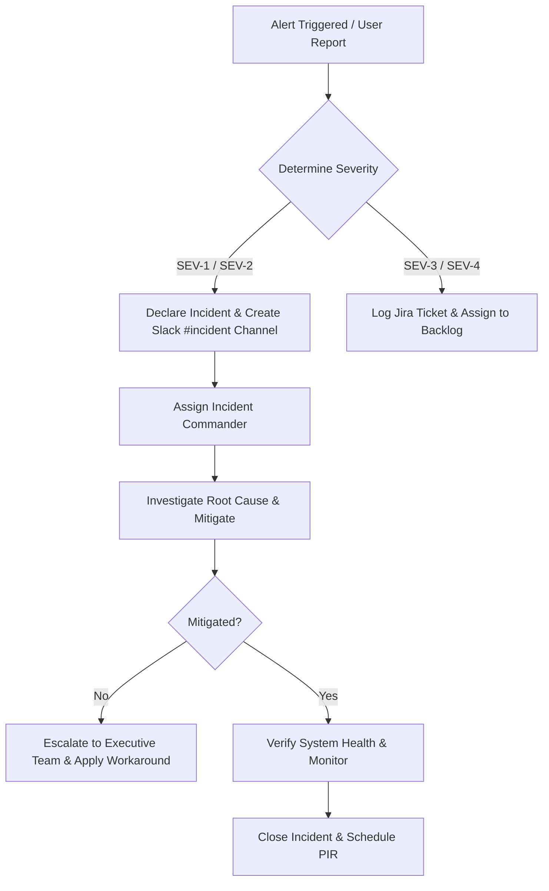

# PillCare Incident Management & Response Framework

## 1. Incident Severity Definitions

| Severity | Definition | Target Response (TTR) | Target Resolution (RTO) | Escalation Contact |
|---|---|---|---|---|
| **SEV-1 (Critical)** | Core notification engine down, backend DB unreachable, or active security breach affecting >10% of active users. | <15 minutes | <1 hour | VP Engineering + On-Call Lead |
| **SEV-2 (High)** | Caregiver sync failure, Firestore sync delays >5 mins, or partial API failure impacting non-critical screens (e.g. Refill UI). | <30 minutes | <4 hours | Lead Backend Engineer |
| **SEV-3 (Medium)** | Non-blocking UI glitch, slow analytics logging, or single region API latency spikes ($>500\text{ms}$). | <2 hours | <24 hours | On-Call Engineer |
| **SEV-4 (Low)** | Minor cosmetic issue, documentation typo, or non-user-impacting administrative tool bug. | Next Business Day | Next Sprint | Team Backlog |

---

## 2. Incident Response Workflow



### Steps:
1. **Identification**: Automated GCP Cloud Monitoring alarm or user incident ticket.
2. **Containment**: Immediately isolate affected Cloud Run instances or roll back to last known stable container tag.
3. **Communication**: Update status page (`status.pillcare.in`) within 15 minutes for SEV-1/SEV-2.
4. **Resolution**: Deploy hotfix via CI/CD pipeline or apply emergency configuration change via GCP Secret Manager.
5. **Post-Incident Review (PIR)**: Conduct blameless root cause analysis within 48 hours for all SEV-1 and SEV-2 events.

---

## 3. On-Call Runbooks

### Runbook A: Alarm Triggered for Notification Failures
1. Check Cloud Watch / Firebase Cloud Messaging (FCM) error status codes.
2. Verify FCM server key validity in GCP Secret Manager (`FCM_SERVER_KEY`).
3. Test payload dispatch via `curl`:
   ```bash
   curl -X POST -H "Authorization: key=$FCM_SERVER_KEY" \
     -H "Content-Type: application/json" \
     -d '{"to":"TEST_DEVICE_TOKEN","notification":{"title":"Test","body":"Ping"}}' \
     https://fcm.googleapis.com/fcm/send
   ```
4. If FCM API returns 401/403, rotate key via Secret Manager and deploy hotfix.

### Runbook B: High Database Connections / Thread Exhaustion
1. Check Postgres active connection count:
   ```sql
   SELECT count(*) FROM pg_stat_activity WHERE state = 'active';
   ```
2. Terminate long-running locking queries if necessary:
   ```sql
   SELECT pg_terminate_backend(pid) FROM pg_stat_activity WHERE duration > interval '5 minutes';
   ```
3. Scale Cloud Run max instances to handle spike while connection pooler resets.
