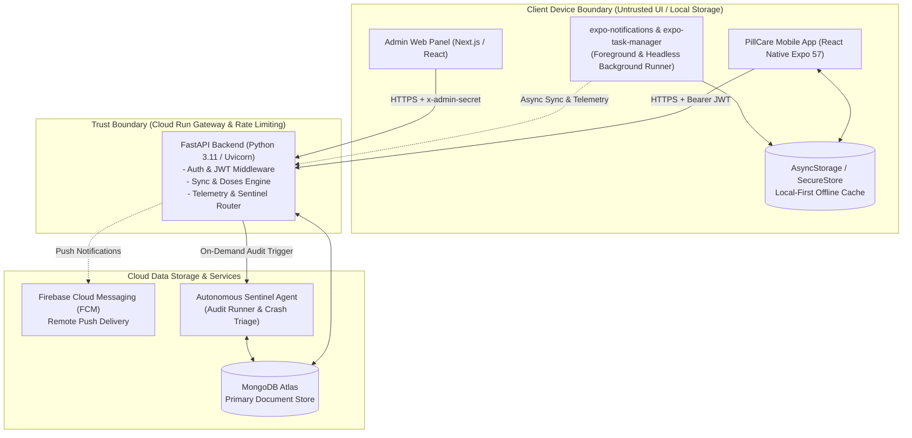

# ARCHITECTURE: PillCare High-Level System Map

> **Scope**: 1-Page Architectural Overview  
> **Deeper References**: Root [`ARCHITECTURE.md`](../ARCHITECTURE.md), [`docs/FLOW.md`](FLOW.md), [`docs/DATA.md`](DATA.md)

---

## 1. Modules & Ownership

### Module Responsibilities:
1. **PillCare Mobile Frontend (`frontend/src/`)**:
   - Manages UI tabs (`Today`, `Treatment`, `Progress`, `Yoga`, `Support`).
   - Owns local-first offline storage (`sync.ts`) and deterministic dose status resolution.
   - Executes local notification scheduling and headless action interception (`notifications.ts`).
2. **FastAPI Cloud Run Backend (`backend/server.py`)**:
   - Authorizes requests via JWT (`/auth/*`) and admin headers (`x-admin-secret`).
   - Serves consolidated atomic sync payloads (`/api/me/sync-state`) to minimize cloud latency and costs.
   - Enforces business logic: dose updates, streak calculations, payments, and push delivery.
3. **Autonomous Sentinel Agent (`backend/agent/sentinel_agent.py`)**:
   - Runs periodic or on-demand telemetry triage against `db.crash_reports`, `db.analytics_events`, and Cloud Run performance logs.
   - Generates executive engineering diagnostic reports for the Chief of Engineering.
4. **Admin Panel (`admin-panel/`)**:
   - Operations portal for monitoring user cohorts, telemetry audits, revenue, and flash announcements.

---

## 2. Trust Boundaries & Data Flow

- **External Input**: All payloads crossing into FastAPI from mobile or web must pass Pydantic schema validation.
- **Client Cache Independence**: The mobile client is designed to operate completely offline. Network sync is asynchronous and idempotent.
- **Security Perimeter**: Production secrets and MongoDB credentials reside strictly in Google Cloud Secret Manager / `.env` on Cloud Run.
