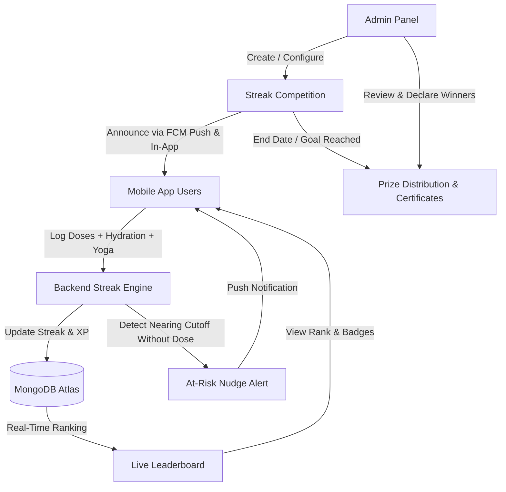

# PillCare Universal Health Streak & Competition Engine Workflow

## 1. Executive Summary & Philosophy
The **PillCare Universal Health Streak & Competition Engine** transforms routine medication compliance, hydration, and wellness into an engaging, gamified daily habit. 

In healthcare, patient adherence drops significantly after the first 14 days of prescription. By coupling clinically sound medication reminders with a transparent, competitive health streak leaderboard, PillCare drives sustained 30-day and 90-day patient retention while giving healthcare administrators full visibility and intervention capabilities.

---

## 2. Core Streak Architecture & Calculation Rules

### A. Daily Qualifying Action (Adherence Triggers)
A patient earns an increment to their **Health Streak (+1 Day)** when they meet **either** of the following daily thresholds before local midnight (23:59:59):
1. **Medication Adherence ≥ 80%**: Taking all prescribed doses for the day, or taking at least 80% if multiple doses are scheduled.
2. **Hydration & Wellness Fallback (Rest Days / As-Needed Meds)**:
   - For patients with no scheduled medications on a given day (e.g., as-needed/PRN prescriptions), completing their mandatory **Daily Hydration Target** (e.g., 2,000 mL) or logging a **Clinical Yoga Session** qualifies for the day's streak.

### B. Grace Period & Timezone Alignment
- **Local Time Calculation**: Streaks are evaluated according to the patient's local timezone (e.g., `Asia/Kolkata`), not server UTC, ensuring fairness.
- **Same-Day Grace Window**: If a morning or afternoon dose is delayed, the user's past streak remains **Active** throughout the current day until 23:59:59 local time, allowing evening reconciliation.

### C. Streak Saver Shield (Freeze Protection)
- **Concept**: Patients occasionally face emergencies, travel disruptions, or acute illnesses where strict routine is disrupted.
- **Mechanics**:
  - Users can claim or activate **1 Daily Streak Saver Shield** per week via the app.
  - If a patient misses all scheduled doses on a shielded day, the shield is consumed, and the streak is **Frozen** rather than reset to zero.
  - Administrators can also grant **VIP / Clinical Streak Shields** directly from the Admin Panel.

### D. Anti-Tamper & Fair Play Validation
- **No Future Pre-Logging**: Dose confirmations with timestamps in the future are rejected.
- **Rate-Limited Dosing**: Minimum spacing enforced between multiple doses of the same medication to prevent artificial bulk-logging.
- **Offline Sync Replay**: Doses recorded while offline are verified against the device's monotonic clock before applying streak increments.

---

## 3. Competition Structure & Seasonal Challenges



### Active Competition Formats

| Challenge Name | Target Streak | Duration | Eligible Users | Rewards & Prizes |
| :--- | :---: | :---: | :---: | :---: |
| **30-Day PillCare Health Sprint** | 30 Days | 30 Days | All Users (Free & Pro) | ₹10,000 Cash Pool + 1 Year Free Pro + Grand Master Certificate |
| **7-Day Hydration & Dose Kickstart** | 7 Days | Rolling Weekly | New & Recovering Users | 500 Health XP + "7-Day Warrior" Digital Trophy |
| **Corporate / Community Adherence Cup** | 21 Days | Quarterly | Teams & Care Groups | Custom Health Hampers + Corporate Adherence Trophy |

### Leaderboard Ranking Formula
In case of equal streak days, champions are ranked by their holistic engagement:
$$\text{Rank Score} = (\text{Streak Days} \times 10,000) + (\text{Health XP}) + (\text{Adherence \%} \times 10)$$

1. **Primary Rank**: Active Consecutive Streak Days (Highest first).
2. **Secondary Tie-Breaker**: Total Accumulated Health XP (Doses + Yoga + Water).
3. **Tertiary Tie-Breaker**: 30-Day Medication Adherence Percentage.

---

## 4. Gamified Tier Ladder & Rewards

```
┌─────────────────────────────────────────────────────────────┐
│ 🏆 GRAND MASTER CHAMPION (Streak: 30+ Days)                 │
│ 4x XP Multiplier 🔥🔥🔥🔥 | Ribbon Badge | Certificate       │
├─────────────────────────────────────────────────────────────┤
│ 🎖️ ADHERENCE LEGEND (Streak: 14 - 29 Days)                  │
│ 3x XP Multiplier 🔥🔥🔥 | Trophy Badge | 1-Mo Pro Coupon    │
├─────────────────────────────────────────────────────────────┤
│ ⚡ STREAK WARRIOR (Streak: 7 - 13 Days)                     │
│ 2x XP Multiplier 🔥🔥 | Flash Badge | Leaderboard Entry     │
├─────────────────────────────────────────────────────────────┤
│ 🌱 HEALTH STARTER (Streak: 1 - 6 Days)                      │
│ 1x XP Base Rate | Daily Motivation Prompts                  │
└─────────────────────────────────────────────────────────────┘
```

---

## 5. Admin Panel Management & Visibility Controls

The **Admin Streak Management Dashboard** (`/engagement/streaks`) provides enterprise healthcare administrators with end-to-end command:

### 1. Real-Time Telemetry Cards
- **Active Streaks**: Total platform users currently maintaining an active streak $\ge 1$ day.
- **Average Adherence Streak**: Platform-wide mean consecutive streak duration.
- **Longest Record Streak**: Historical highest streak achieved by any patient.
- **Streaks At Risk Today**: Count of patients on active streaks who have pending doses as evening approaches.

### 2. Competition Lifecycle Controls
- **Create Competition**: Configure Title, Target Streak, Start/End Dates, Prize Pool, and Custom Rules.
- **Pause / Resume**: Instantly toggle competition visibility and score accumulation.
- **Declare Winners**: Automatically lock the leaderboard at competition close and issue winner awards.

### 3. Patient Care & Dispute Resolution Actions
- **Grant Streak Shield**: Manually protect a patient's streak due to reported medical hospitalizations or technical errors.
- **Recalculate / Adjust Streak**: Modify streak days with mandatory audit-logging explanation.
- **Nudge At-Risk Cohort**: Trigger high-priority FCM v1 push notifications to all users whose streaks will break at midnight.

---

## 6. End-to-End Verification & Quality Control Standard

| QC Stage | Verification Criteria | Expected Outcome |
| :--- | :--- | :--- |
| **Mobile App: Today Screen** | Flame icon and streak badge visible in header and adherence card. | Correct count displayed without flicker. |
| **Mobile App: Leaderboard Modal** | Tap streak $\to$ opens `CalendarModal.tsx` on `Streak Ranks` tab. | Shows User Rank, Tier, Streak, Adherence %, and Top 10 Champions. |
| **Mobile App: Shield Activation** | Tap "Activate Daily Streak Saver Shield". | Changes to "Daily Streak Saver Activated" and caches state locally. |
| **Admin Panel: Navigation** | "Streak & Competitions" visible in Sidebar with Flame icon. | Click navigates directly to `/engagement/streaks`. |
| **Admin Panel: Telemetry** | Displays Live KPIs (Active Streaks, Avg, Record, At-Risk). | Fetched from live backend `/admin/streaks` or MongoDB Atlas. |
| **Admin Panel: Competition Card** | Active competitions listed with countdown, targets, and prizes. | Toggle status updates state instantaneously. |
| **Admin Panel: Leaderboard** | Full table of users with Rank, Streak Days, Adherence %, XP, Tier. | Searchable and actionable. |
| **Admin Panel: At-Risk Push** | Click "⚡ Nudge At-Risk Users". | Dispatches high-priority reminder alert via FCM v1. |
