# PillCare - Complete Application Workflows Reference Manual

> **Purpose**: Definitive, end-to-end architectural and operational guide mapping all user and system execution paths in the PillCare ecosystem.  
> **Audience**: AI Agents, Engineers, QA Leads, and the Chief of Engineering.  
> **Key Principle**: Every user action must be traceable from the UI trigger or OS hardware intent down to local storage, background queues, and Cloud Run MongoDB records.

---

## Table of Workflows

1. [Workflow 1: Interactive Notification Shade Bar Actions (Zero-Lag Headless Execution)](#workflow-1-interactive-notification-shade-bar-actions)
2. [Workflow 2: Exact Alarm Scheduling & Clinical Pacing Cadence](#workflow-2-exact-alarm-scheduling--clinical-pacing-cadence)
3. [Workflow 3: The 7 Laws of PillCare Local-First Synchronization Engine](#workflow-3-the-7-laws-of-pillcare-local-first-synchronization-engine)
4. [Workflow 4: Offline Durable Mutation Queue & Pre-Signout Draining](#workflow-4-offline-durable-mutation-queue--pre-signout-draining)
5. [Workflow 5: Today Dashboard Silent SWR Hydration & Cache Invalidation](#workflow-5-today-dashboard-silent-swr-hydration--cache-invalidation)
6. [Workflow 6: Renal-Safe Hydration Tracking & Pacing Lockout](#workflow-6-renal-safe-hydration-tracking--pacing-lockout)
7. [Workflow 7: AI Yoga Therapy & Guided Flow Deep-Link Routing](#workflow-7-ai-yoga-therapy--guided-flow-deep-link-routing)
8. [Workflow 8: Medication Inventory Management & Refill Warnings](#workflow-8-medication-inventory-management--refill-warnings)
9. [Workflow 9: Android Battery Optimization Exemption & OEM Doze Bypass](#workflow-9-android-battery-optimization-exemption--oem-doze-bypass)
10. [Workflow 10: Server Cloud Run Cost Optimization & Polling Throttling](#workflow-10-server-cloud-run-cost-optimization--polling-throttling)
11. [Workflow 11: Autonomous Sentinel Agent Telemetry & Bug Triage](#workflow-11-autonomous-sentinel-agent-telemetry--bug-triage)
12. [Workflow 12: 5-Stage Local & CI/CD Native Release Build Pipeline](#workflow-12-5-stage-local--cicd-native-release-build-pipeline)

---

## Workflow 1: Interactive Notification Shade Bar Actions

Enables patients to confirm medications, skip doses, or log water intake directly from their lock screen or Android notification shade without opening or foregrounding the app.

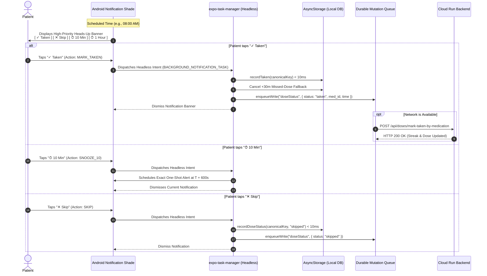

### Key Implementation Invariants:
1. **Module-Scope Task Registration**: The headless task `BACKGROUND_NOTIFICATION_TASK` in [`frontend/src/lib/notifications.ts`](../frontend/src/lib/notifications.ts) MUST remain registered outside React component render trees.
2. **Sub-10ms Local Execution**: Tapping an action writes synchronously into `AsyncStorage` using `recordTaken()`. The patient does not wait for HTTP requests.
3. **Escalation Cancellation**: Marking taken immediately cancels any pending secondary alerts scheduled for 30 minutes later.

---

## Workflow 2: Exact Alarm Scheduling & Clinical Pacing Cadence

Adheres to gold-standard clinical reminder guidelines modeled after MyTherapy and Apple Health.

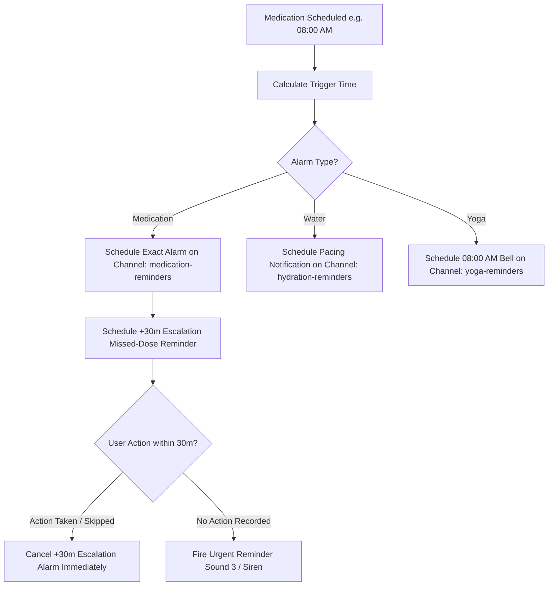

### Android Notification Channel Configuration:
- `medication-reminders`: Importance `MAX`, sound enabled, custom vibration `[0, 500, 250, 500]`, lockscreen visibility `PUBLIC`.
- `hydration-reminders`: Importance `HIGH`, gentle water droplet sound.
- `yoga-reminders`: Importance `MAX`, peaceful Tibetan bell chime.
- `broadcasts`: Importance `MAX`, administrative and clinical announcements.

---

## Workflow 3: The 7 Laws of PillCare Local-First Synchronization Engine

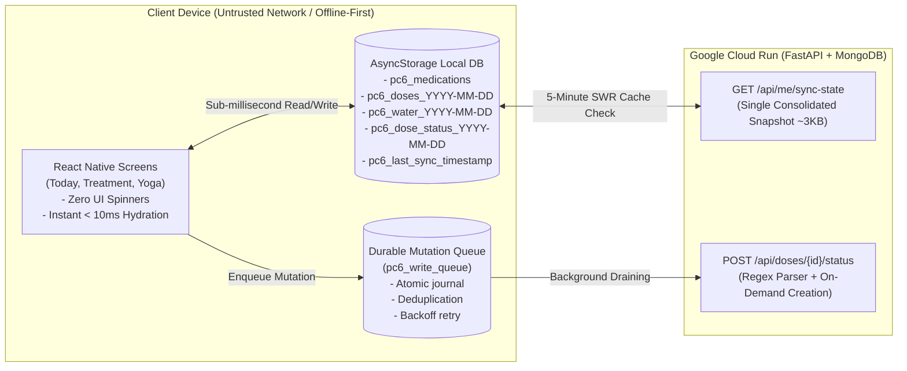

### The 7 Laws:
1. **Local State is Single Source of Truth**: UI renders strictly from `AsyncStorage`. Blocking network calls before screen mount are prohibited.
2. **Local Taken Always Wins**: If local registry has `taken` or `skipped`, it overrides server `pending` status during [`mergeDoses()`](../frontend/src/lib/sync.ts).
3. **Durable Mutation Queue (`pc6_write_queue`)**: Mutations are journaled to disk before dispatch. Retries survive app kills.
4. **Pre-Signout Queue Drain**: [`signOut()`](../frontend/src/lib/auth.ts) races a 2-second queue flush before clearing local credentials, preventing Device A ➔ Device B data loss.
5. **Atomic Delta Hydration**: Login and catch-up use `GET /api/me/sync-state` (~3KB gzip) to populate all local tables in one single payload.
6. **Persisted SWR Cache TTL**: `lastSyncTimestamp` is stored in `AsyncStorage`. Tab switches check local TTL (5-minute window). No network call is made if data is fresh. Background syncs hide the loading spinner.
7. **Event-Sourced Hydration Merging**: Water intake is stored as discrete timestamped events (`{ amount, ts }`) rather than a single overwritable number.

---

## Workflow 4: Offline Durable Mutation Queue & Pre-Signout Draining

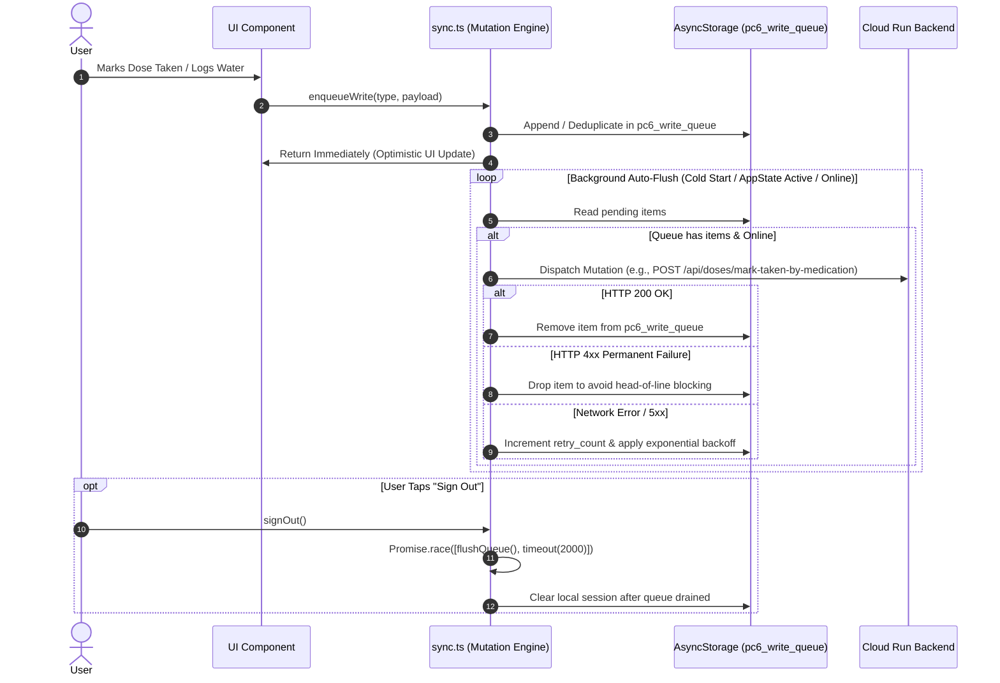

---

## Workflow 5: Today Dashboard Silent SWR Hydration & Cache Invalidation

Eliminates annoying `"Updating latest data..."` UI flickers and cuts Cloud Run server invocations by over 83%.

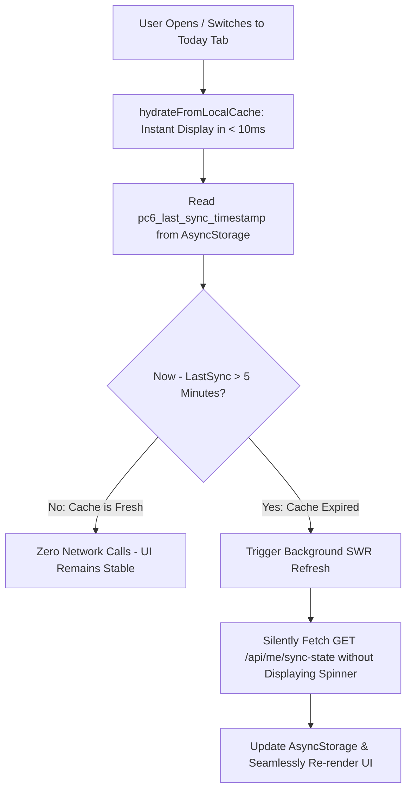

---

## Workflow 6: Renal-Safe Hydration Tracking & Pacing Lockout

Protects patient kidney health by enforcing the World Health Organization (WHO) and clinical nephrology pacing limits.

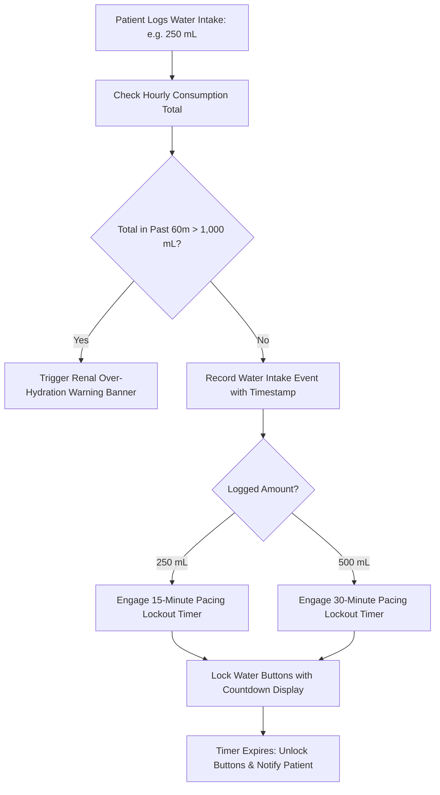

---

## Workflow 7: AI Yoga Therapy & Guided Flow Deep-Link Routing

Integrates daily wellness routines verified by Ministry of AYUSH & Swami Ramdev guidelines.

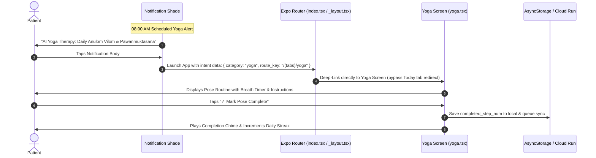

---

## Workflow 8: Medication Inventory Management & Refill Warnings

Prevents dangerous medication stockouts for chronic conditions.

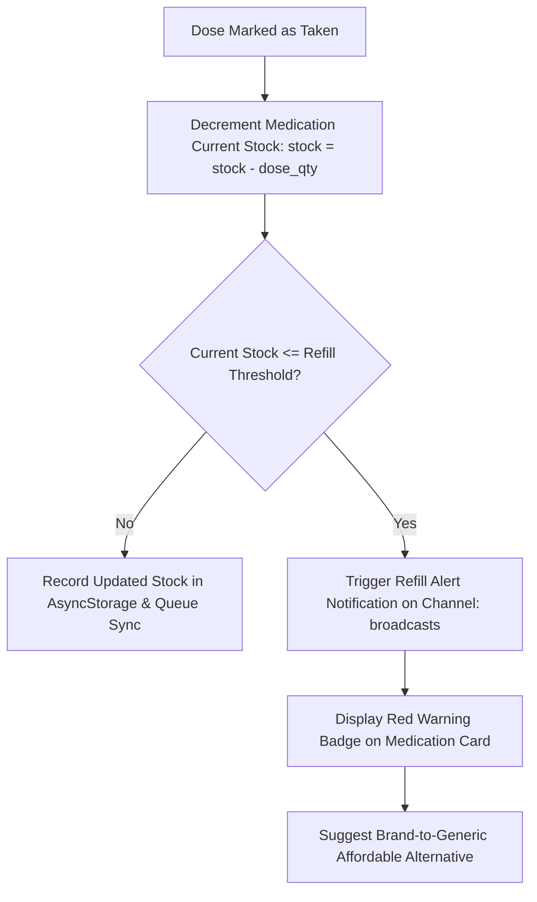

---

## Workflow 9: Android Battery Optimization Exemption & OEM Doze Bypass

Ensures aggressive OEM task managers (OnePlus OxygenOS, Oppo ColorOS, Xiaomi HyperOS, Samsung OneUI) do not suppress exact alarms.

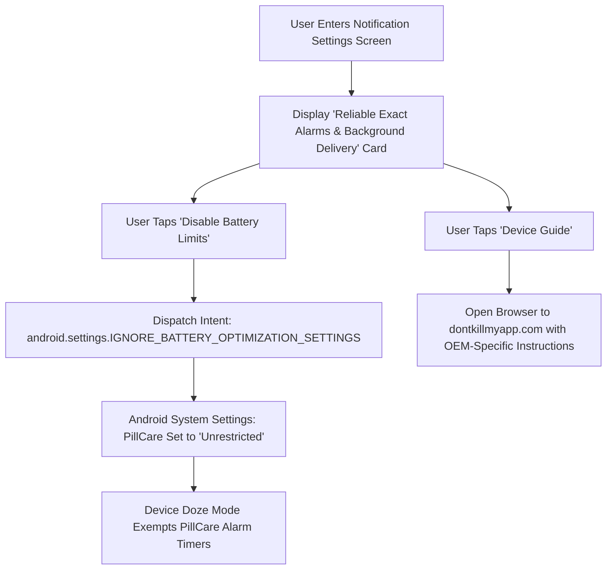

---

## Workflow 10: Server Cloud Run Cost Optimization & Polling Throttling

```mermaid
flowchart TD
    subgraph Before_Optimization ["Before Optimization (High Cloud Billing)"]
        B1[Tab Switch Today ➔ Server Hit]
        B2[Tab Switch Treatment ➔ Server Hit]
        B3[App Resume ➔ Unconditional 60s Heartbeat]
        B4[Sign In ➔ 6 Parallel HTTP Requests]
    end

    subgraph After_Optimization ["After Optimization (> 83% Cost Reduction)"]
        A1[Tab Switch ➔ Check 5m Persisted SWR TTL (Zero Network if Fresh)]
        A2[App Resume ➔ Heartbeat Throttled to 15m Cooldown]
        A3[Sign In ➔ Single Consolidated GET /api/me/sync-state (~3KB gzip)]
    end
```

---

## Workflow 11: Autonomous Sentinel Agent Telemetry & Bug Triage

Continuous health monitoring designed for the Chief of Engineering.

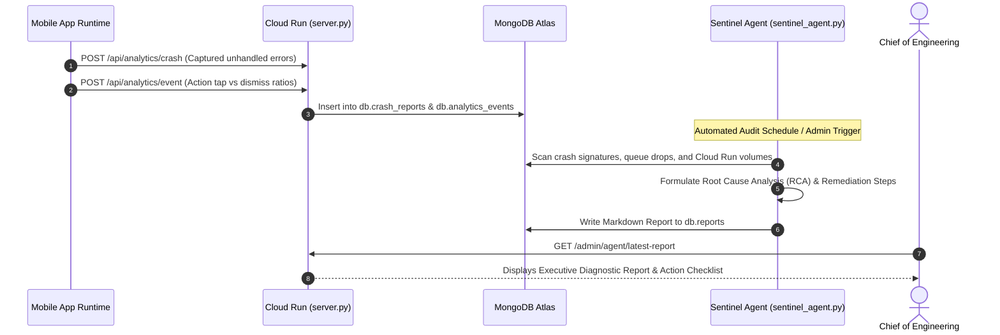

---

## Workflow 12: 5-Stage Local & CI/CD Native Release Build Pipeline

Guarantees reproducible, crash-free standalone release APKs.

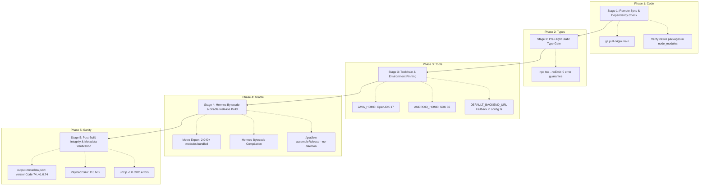

---

## Cross-Reference Mapping

| Feature Area | Key Implementation Files | Primary Invariant |
| :--- | :--- | :--- |
| **Notification Shade Actions** | [`frontend/src/lib/notifications.ts`](../frontend/src/lib/notifications.ts) | Must execute at module scope in `< 10ms` without foregrounding app. |
| **Local-First Sync Engine** | [`frontend/src/lib/sync.ts`](../frontend/src/lib/sync.ts) | Local `taken` status always overrides server `pending` status. |
| **Centralized Config & URL Fallback** | [`frontend/src/lib/config.ts`](../frontend/src/lib/config.ts) | Guaranteed production backend URL prevents relative URL crashes. |
| **Offline Mutation Queue** | [`frontend/src/lib/sync.ts`](../frontend/src/lib/sync.ts) | Writes persisted to disk; drained before signout. |
| **Cloud Run API & Resolver** | [`backend/server.py`](../backend/server.py) | Regex parser resolves canonical dose IDs with on-demand dose synthesis. |
| **Autonomous Sentinel Agent** | [`backend/agent/sentinel_agent.py`](../backend/agent/sentinel_agent.py) | Automated daily diagnostics and crash triage for Chief Engineer. |
| **Release Build Configuration** | [`frontend/android/app/build.gradle`](../frontend/android/app/build.gradle) | Pinned to React Native 0.86, Expo SDK 57, Java 17, and Hermes. |
