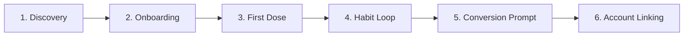

# Codebase, Feature & UX Review Report — PillCare Platform

**Date:** October 4, 2026  
**Audience:** Development, Product & QA Teams  
**Target Repository:** PillCare Reminder V01 (Backend: FastAPI/MongoDB; Frontend: React Native/Expo SDK 52)

---

## Executive Summary & Review Scope

This review documents verified security, architecture, state management, notification, UX, and accessibility findings across the PillCare platform. Findings are categorized into standard review sections, ordered by severity within each section, and explicitly flagged as either **[fixed in plan]** (addressed in the immediate technical implementation plan) or **[recommendation]** (deferred to future architectural phases).

---

## 1. Verified Audit Findings by Section

### Section A: Backend Security & Authentication

1. **[fixed in plan] Global Shared Guest Identity causing Cross-Account Data Leakage**
   - **Location:** [`backend/server.py:386-391`](file:///Users/nitin/Documents/PillCare-Reminder_V01.1/Pillcare-Reminder_V01/backend/server.py#L386-L391)
   - **Severity:** Critical
   - **Description:** `get_current_user_id` maps any header starting with `Bearer demo_token_` or equal to `guest` directly to the static string `"demo_user"`. All unauthenticated guests read and write to the same MongoDB profile, medications, and dose records.
   - **Fix Strategy:** Add `POST /api/auth/guest` returning isolated `guest_<uuid>` tokens with `is_guest: true`. Remove static demo mappings from `get_current_user_id`.

2. **[fixed in plan] Unauthenticated Subscription Upgrade Endpoint**
   - **Location:** [`backend/server.py:3272-3300`](file:///Users/nitin/Documents/PillCare-Reminder_V01.1/Pillcare-Reminder_V01/backend/server.py#L3272-L3300)
   - **Severity:** High
   - **Description:** `/api/me/upgrade` allows any caller to self-grant Premium/Enterprise subscription features by sending a POST request without payment verification.
   - **Fix Strategy:** Restrict `/api/me/upgrade` to authenticated admin roles only. Require HMAC webhook signature validation for payment activation endpoints.

3. **[fixed in plan] Push Token Overwrite via Unauthenticated Body Payload**
   - **Location:** [`backend/server.py:726-764`](file:///Users/nitin/Documents/PillCare-Reminder_V01.1/Pillcare-Reminder_V01/backend/server.py#L726-L764)
   - **Severity:** High
   - **Description:** `save_push_token_flexible` reads `user_id` or `email` from the unauthenticated request body payload if the Authorization header parse fails, enabling malicious callers to hijack push tokens.
   - **Fix Strategy:** Enforce `Depends(get_current_user_id)` authentication on push token registration and use the authenticated JWT identity exclusively.

4. **[fixed in plan] Hardcoded Admin Secret Fallback**
   - **Location:** [`backend/server.py:2828-2844`](file:///Users/nitin/Documents/PillCare-Reminder_V01.1/Pillcare-Reminder_V01/backend/server.py#L2828-L2844)
   - **Severity:** Medium
   - **Description:** Fallback `valid_secrets` contains `"pillcare_admin_secret_key_2026"` hardcoded when `ADMIN_SECRET` environment variable is unset.
   - **Fix Strategy:** Remove hardcoded admin secret strings; reject admin operations if `ADMIN_SECRET` is unconfigured.

5. **[recommendation] Admin Panel Role-Based Access Control (RBAC)**
   - **Location:** [`backend/server.py:2820-2860`](file:///Users/nitin/Documents/PillCare-Reminder_V01.1/Pillcare-Reminder_V01/backend/server.py#L2820-L2860)
   - **Severity:** Medium
   - **Description:** Admin endpoints rely on header string checks rather than structured scope/role-based JWT claims.
   - **Recommendation:** Implement fine-grained RBAC permissions (`admin:read`, `admin:write`, `support:read`) within JWT scopes.

---

### Section B: Frontend Session & Data Isolation

1. **[fixed in plan] Synthetic Guest Authentication & Fake Local Tokens**
   - **Location:** [`frontend/src/lib/auth.ts:104-115`](file:///Users/nitin/Documents/PillCare-Reminder_V01.1/Pillcare-Reminder_V01/frontend/src/lib/auth.ts#L104-L115)
   - **Severity:** High
   - **Description:** `signInAsGuest()` generates fake client-side tokens (`demo_token_*`) without invoking the backend API, causing API sync calls to fail or map to shared demo profiles.
   - **Fix Strategy:** Call `POST /api/auth/guest` from `signInAsGuest()`, storing the returned guest JWT and setting `is_guest: true`.

2. **[fixed in plan] Cross-User Write Queue Leakage & Unsafe Sign-Out Cleanup**
   - **Location:** [`frontend/src/lib/sync.ts:18-40`](file:///Users/nitin/Documents/PillCare-Reminder_V01.1/Pillcare-Reminder_V01/frontend/src/lib/sync.ts#L18-L40), [`frontend/src/lib/auth.ts:144-152`](file:///Users/nitin/Documents/PillCare-Reminder_V01.1/Pillcare-Reminder_V01/frontend/src/lib/auth.ts#L144-L152)
   - **Severity:** High
   - **Description:** `pc6_write_queue` stores pending offline mutations without owner tagging. When User A signs out and User B signs in, User B's sync flushes User A's queued writes under User B's token.
   - **Fix Strategy:** Tag queued items with `owner_id`. Filter queue reads by active user. Clear all caches, queues, taken registries, and scheduled notification channels during sign-out.

3. **[fixed in plan] Missing Central 401 Session Invalidation**
   - **Location:** [`frontend/src/lib/api.ts:6-32`](file:///Users/nitin/Documents/PillCare-Reminder_V01.1/Pillcare-Reminder_V01/frontend/src/lib/api.ts#L6-L32)
   - **Severity:** Medium
   - **Description:** Unhandled 401 HTTP responses leave stale tokens in `SecureStore`, resulting in silent network failures across screens.
   - **Fix Strategy:** Intercept 401 status centrally in `api.ts`, trigger immediate sign-out cleanup, and route to `/sign-in`. Allow cached fallbacks only for network/offline errors.

---

### Section C: Notification Semantics & Rescheduling

1. **[fixed in plan] Erroneous Adherence Recording on Ordinary Banner Taps**
   - **Location:** [`frontend/src/lib/notifications.ts:130-155`](file:///Users/nitin/Documents/PillCare-Reminder_V01.1/Pillcare-Reminder_V01/frontend/src/lib/notifications.ts#L130-L155)
   - **Severity:** High
   - **Description:** `Notifications.DEFAULT_ACTION_IDENTIFIER` (tapping notification banner to open app) triggers `markTakenByMedication`, marking doses taken without explicit user confirmation.
   - **Fix Strategy:** Route `DEFAULT_ACTION_IDENTIFIER` to Today screen with dose highlighted. Reserve adherence marking strictly for the `MARK_TAKEN` action button.

2. **[fixed in plan] Aggressive Cancellation of Unrelated Reminders in `resyncReminders`**
   - **Location:** [`frontend/src/lib/notifications.ts:230-275`](file:///Users/nitin/Documents/PillCare-Reminder_V01.1/Pillcare-Reminder_V01/frontend/src/lib/notifications.ts#L230-L275)
   - **Severity:** Medium
   - **Description:** Re-syncing medication notifications cancels all scheduled device notifications indiscriminately, wiping out appointment alerts, water reminders, and snooze timers.
   - **Fix Strategy:** Filter cancellations by category or identifier prefix (`med_`), preserving appointments, hydration, and streak-saver timers.

---

### Section D: UX, Engagement & Gamification

1. **[fixed in plan] Synthetic Leaderboard & Fabricated Social Proof**
   - **Location:** [`backend/server.py:1316-1327`](file:///Users/nitin/Documents/PillCare-Reminder_V01.1/Pillcare-Reminder_V01/backend/server.py#L1316-L1327), [`frontend/app/(tabs)/progress.tsx`](file:///Users/nitin/Documents/PillCare-Reminder_V01.1/Pillcare-Reminder_V01/frontend/app/(tabs)/progress.tsx)
   - **Severity:** Medium
   - **Description:** Progress screen presents hardcoded fake users ("Dr. Priya Sharma", "Rajesh Kumar") as a real community leaderboard.
   - **Fix Strategy:** Remove synthetic leaderboard entries. Display real personal streak metrics, points, and earned badges.

2. **[recommendation] Production Webhook Gateway & Real Payment Processing**
   - **Location:** [`backend/server.py:3306-3340`](file:///Users/nitin/Documents/PillCare-Reminder_V01.1/Pillcare-Reminder_V01/backend/server.py#L3306-L3340)
   - **Severity:** Feature Recommendation
   - **Description:** Gateway signature verification currently operates in stub mode.
   - **Recommendation:** Implement Razorpay/Stripe webhooks with mandatory HMAC SHA256 signature verification in production.

3. **[recommendation] Real Opt-In Community Leaderboard**
   - **Location:** [`backend/server.py:1300-1365`](file:///Users/nitin/Documents/PillCare-Reminder_V01.1/Pillcare-Reminder_V01/backend/server.py#L1300-L1365)
   - **Severity:** Feature Recommendation
   - **Description:** Real multi-tenant leaderboard with privacy opt-in.
   - **Recommendation:** Build opt-in MongoDB cohort aggregation for real user streaks when active opted-in user count exceeds 50.

---

## 2. Six-Stage Activation Loop & Product Metrics

### Activation Stage Specifications:
1. **Discovery / Sign-In:** Frictionless guest access via 48dp "Continue without account" CTA alongside Google Auth.
2. **Onboarding:** Skippable "Add first medication" flow using `AddMedicationSheet`. Immediate notification permission prompt following dose save.
3. **First Confirmed Dose:** Instant feedback via `SaveProgressPrompt` upon completing the first dose action.
4. **Habit Loop:** Uncapped streak counter on Today & Progress screens, supported by a 6 PM dynamic streak-saver notification.
5. **Conversion Prompt:** Contextual `SaveProgressPrompt` presented at 3-day streak or before configuring caregiver alerts.
6. **Account Linking:** Seamless progress migration from `guest_<uuid>` to authenticated Google JWT in `POST /api/auth/google`.

---

## 3. Accessibility & Touch Target Acceptance Baselines

- **Minimum Touch Target:** All interactive controls, chips, and buttons MUST maintain a minimum size of **48dp × 48dp**.
- **Explicit Accessibility Attributes:** Every clickable component must specify `accessibilityLabel`, `accessibilityRole`, and `accessibilityState` (e.g. `selected` on gender chips).
- **Test ID Baseline:** All interactive elements must include kebab-case `testID` attributes (e.g., `testID="guest-continue-btn"`).
- **Device Checks Baseline:**
  - Screen Readers: VoiceOver (iOS) and TalkBack (Android) focus order.
  - Dynamic Font Scaling: Layout adaptability at 200% system font size.
  - Small Viewports: Full scrollability on 320dp screen width (e.g. iPhone SE / Android Small).
  - Notification Delivery: Real OS notification banner execution on Android 8–15 release devices.

---
